# Quasy — Personal Portfolio Website

Quasy is a personal portfolio website for Khwezi, a web development student. The site
shows information about Khwezi, his skills, his projects and how to contact him.

## Pages

- `index.html` — Home
- `about.html` — About
- `skills.html` — Skills
- `projects.html` — Projects
- `contact.html` — Contact

## Folder Structure


Quasy/
├── index.html
├── about.html
├── skills.html
├── projects.html
├── contact.html
├── robots.txt
├── sitemap.xml
├── css/
│   └── style.css
├── images/
│   ├── khwezi-web-developer-profile-small.jpg
│   ├── khwezi-web-developer-profile-large.jpg
│   ├── html-layout-practice-project.jpg
│   ├── css-responsive-design-project.jpg
│   └── flexbox-grid-layout-project.jpg
├── js/
│   ├── main.js
│   ├── projects.js
│   ├── lightbox.js
│   ├── map.js
│   └── form.js
├── screenshots/
└── README.md
```

---

## Part 1 — Planning and Structure

Part 1 focused on planning the website and building the basic HTML structure.

- Researched other portfolio websites for layout and content ideas.
- Planned five pages: Home, About, Skills, Projects and Contact.
- Built each page using semantic HTML: header, navigation, main, sections, headings,
  paragraphs, lists, a contact form and a footer.
- Kept the same header/navigation and footer on every page for consistency.

---

## Part 2 — Designing the Visuals: CSS Styling and Responsive Design

Part 2 focused on styling the website with an external stylesheet and making it work
well on desktop, tablet and mobile screens.

### What was done

1. **External stylesheet** — All five HTML pages link to the same stylesheet:
   `css/style.css`, using `<link rel="stylesheet" href="css/style.css">` in the `<head>`.

2. **CSS reset & base styling** — A simple reset removes default margin/padding and
   sets `box-sizing: border-box`. Base styles set the page font, background colour and
   text colour.

3. **Typography** — Headings and paragraphs use `font-family`, `font-size` (in `rem`),
   `font-weight`, `line-height` and `letter-spacing` to keep text readable and consistent.

4. **Desktop layout** — The header/navigation, hero section and contact section use
   **Flexbox**. The skills and project cards use **CSS Grid** (3 columns on desktop).

5. **Visual styling** — Colours are set with CSS variables (`:root`), including a
   dark blue header/footer and a teal accent colour. Cards and the contact form use
   `border`, `border-radius` and `box-shadow` for depth.

6. **Pseudo-classes** — Navigation links, the button and cards respond to `:hover`,
   `:focus` and `:active` (e.g. the nav underline changes colour on hover/focus, the
   button darkens on hover and shrinks slightly on `:active`).

7. **Responsive design** — Media queries adjust the layout at two breakpoints:
   - **Tablet** (`max-width: 48rem` / 768px): navigation wraps, hero section stacks,
     card grids switch to 2 columns, contact form stacks.
   - **Mobile** (`max-width: 30rem` / 480px): navigation becomes a vertical list,
     headings shrink, card grids switch to 1 column, the button becomes full width.

8. **Relative units** — Spacing, font sizes and container widths use `rem`, `em` and
   `%` instead of fixed pixel values, so the layout scales properly.

9. **Responsive images** — The profile photo on the Home page uses `srcset` and
   `sizes` (and a `<picture>`/`<source>` for larger screens) so a smaller image is
   used on small screens and a larger one on bigger screens.

10. **Testing** — The website was tested at desktop, tablet and mobile widths using
    browser developer tools (see screenshots below).

### Screenshot Evidence

**Home page**

| Desktop | Tablet | Mobile |
|---|---|---|
| 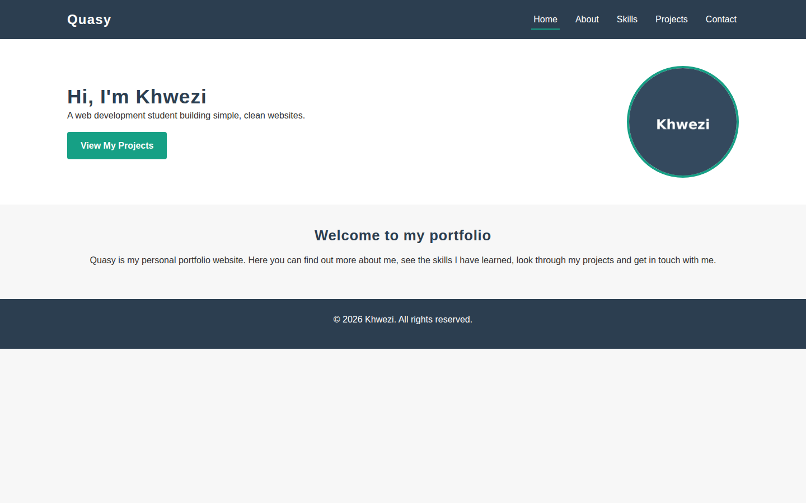 | 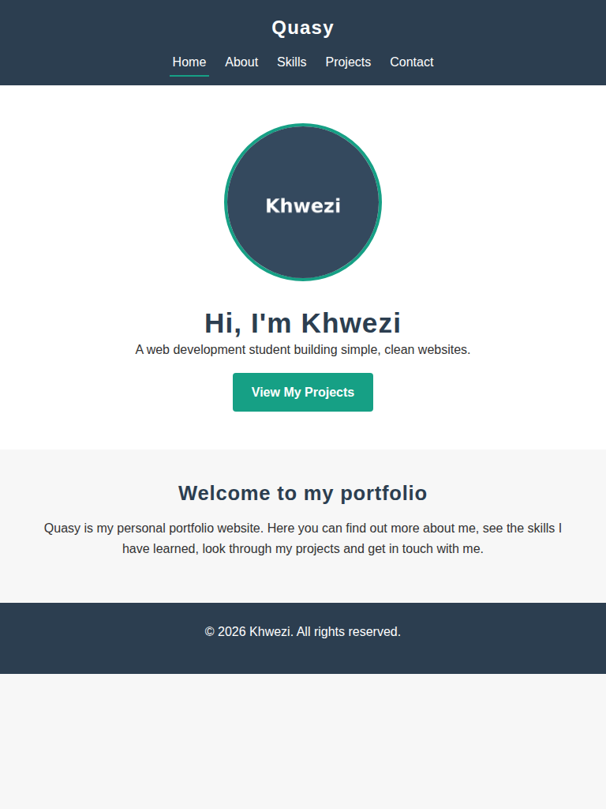 | 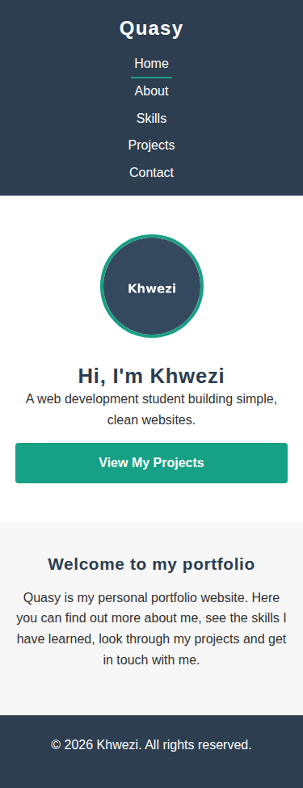 |

**Projects page (Grid layout collapsing)**

| Desktop | Tablet | Mobile |
|---|---|---|
| 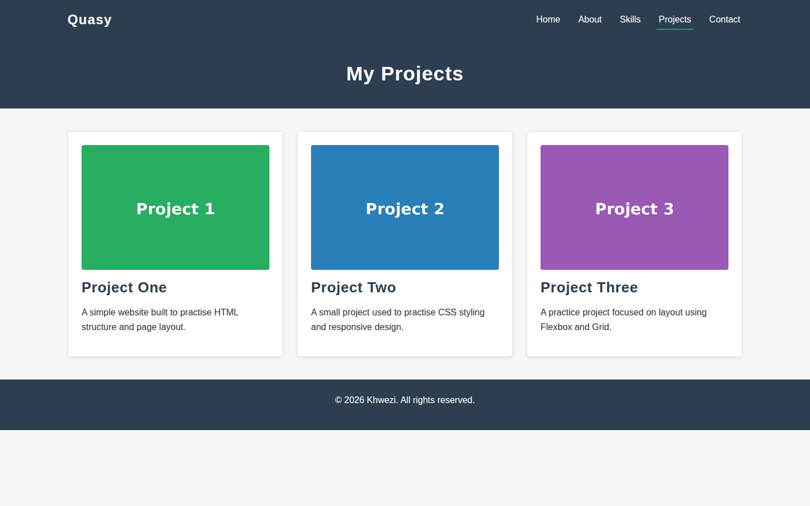 | 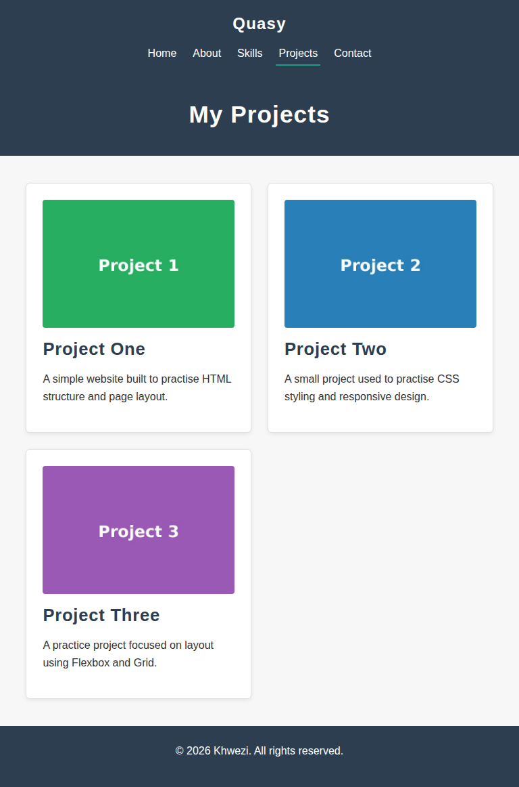 | 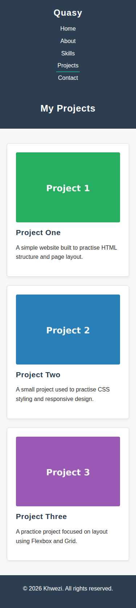 |

**Skills page**

| Desktop | Tablet | Mobile |
|---|---|---|
| 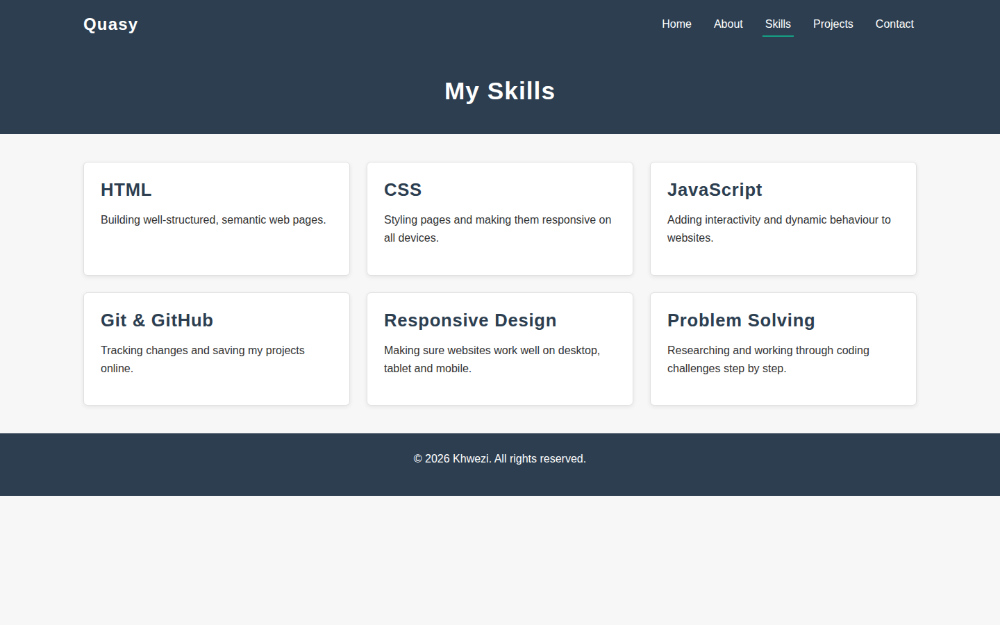 | 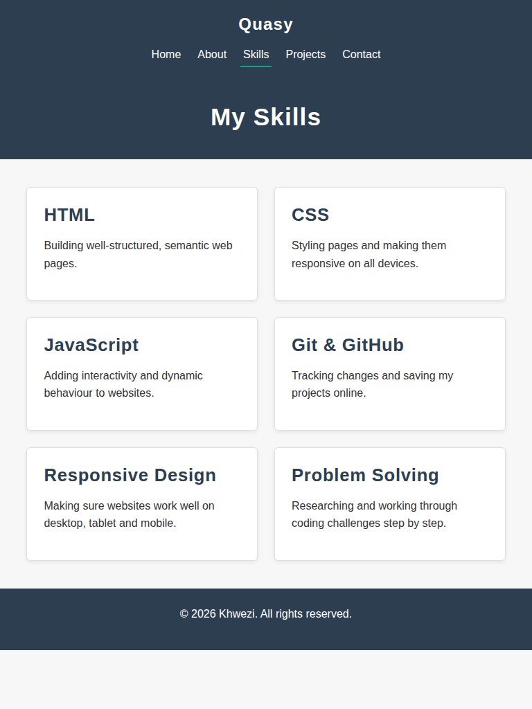 | 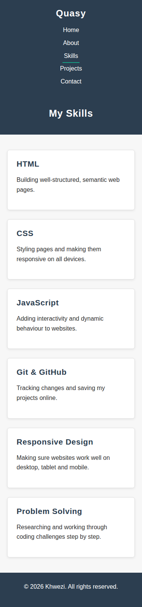 |

**Contact page (Form stacking)**

| Desktop | Tablet | Mobile |
|---|---|---|
| 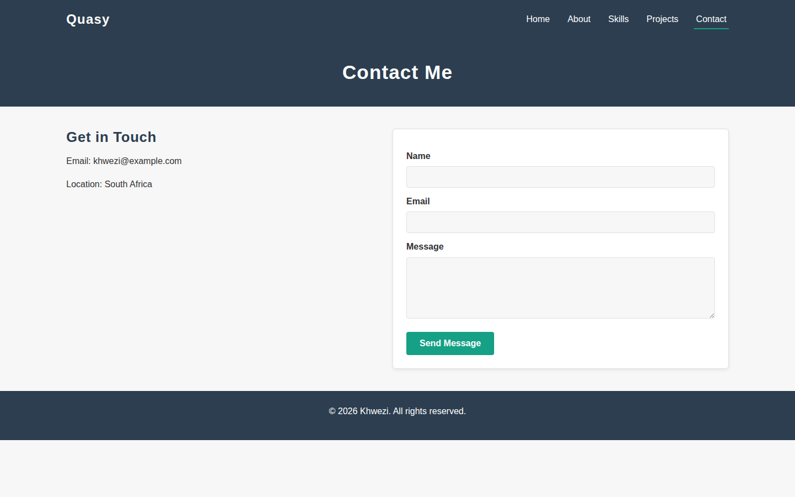 | 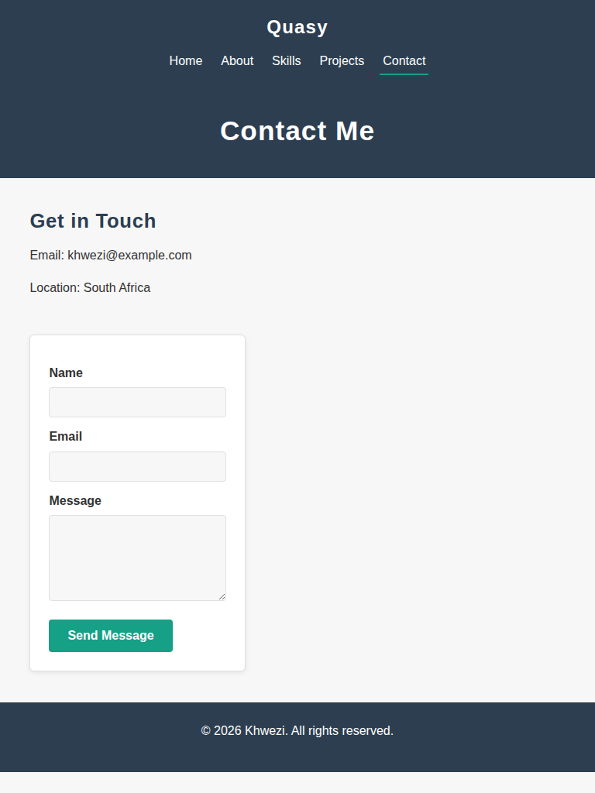 | 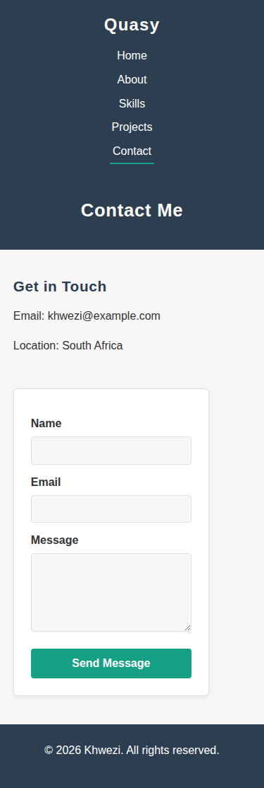 |

---

## Feedback for Part 2 and How I Addressed It

**Lecturer feedback on Part 2:**
> "Outstanding work. External CSS, responsive design, image techniques, documentation and Git history are excellent; add formal references and feedback corrections."

| # | Feedback received | Correction made in Part 3 | Where |
|---|---|---|---|
| 1 | Strengths: external CSS, responsive design, image techniques, documentation and Git history | Kept all of these unchanged. The new CSS was added to the end of `css/style.css` (section 12) and the Part 2 layout, media queries and responsive images were not changed. New work was committed in small, clearly named steps. | `css/style.css`, Git history |
| 2 | "Add formal references" | Added a formal Harvard-style **References** section at the end of this README, with in-text citations in the Part 3 sections. | `README.md` |
| 3 | "Add feedback corrections" | Added this section to record the feedback received and the correction made for each point, and added the corrections to the Part 3 changelog. | `README.md` |

---

## Part 3 — Interactivity, Forms, SEO and Publishing

**Live site:** https://khweziqakosha105.github.io/WEDE-PART-2/

Part 3 builds on the Part 2 website. The existing HTML and CSS were kept and only
small additions were made, with the new behaviour added in separate JavaScript files.

### Interactive elements (`js/main.js`)
- The footer year updates automatically with `new Date().getFullYear()`.
- The Home page shows a greeting based on the time of day.
- A back-to-top button appears after scrolling down and scrolls smoothly to the top.

### Interactive map (`js/map.js`)
The Contact page has an interactive map built with the Leaflet library (Agafonkin, 2023) and OpenStreetMap map data (OpenStreetMap contributors, n.d.), with a marker and popup.

### Gallery lightbox (`js/lightbox.js`)
Clicking a project image opens it in a lightbox with previous/next buttons, a caption,
and keyboard support (Esc to close, arrow keys to move). It is responsive and only
cycles through the projects that match the current search.

### Dynamic content and search (`js/projects.js`)
A search box on the Projects page filters the project cards as the user types. It shows
how many projects are displayed and a message when nothing matches.

### SEO
- A unique, descriptive `<title>` on every page, following Google's SEO guidance (Google Search Central, n.d.).
- A unique meta description and meta keywords on every page.
- Image files renamed with descriptive names (e.g. `css-responsive-design-project.jpg`)
  and more descriptive alt text.
- Canonical links, `robots.txt` and `sitemap.xml`.

### Enquiry form (`js/form.js`)
- **Controls:** name, email, an enquiry-type dropdown, a message box and two checkboxes
  (send me a copy, and consent), all with labels.
- **Validation:** following the client-side validation guidance from MDN Web Docs (n.d.a), each field has its own rule. Errors appear under the field, invalid
  fields turn red, valid fields turn green and focus moves to the first error.
- **Response:** after a valid submission the page shows a reference number and a reply
  time that depends on the enquiry type.

### Publishing
Published with GitHub Pages (GitHub Docs, n.d.) (Settings → Pages → branch `main`, root folder).

### Testing
Each feature was tested on desktop, tablet and mobile widths, and the form was tested
with empty, invalid and valid input. A Lighthouse report was run on the live site.

---

## Changelog

### Part 1
- `2026-09-19` — Added basic HTML structure for Home, About, Skills, Projects and
  Contact pages, with consistent header, navigation and footer.

### Part 2
- `2026-09-19` — Linked external stylesheet (`css/style.css`) to all pages. Added CSS
  reset, base styling and typography rules.
- `2026-09-19` — Built the desktop layout using Flexbox (header, hero, contact) and
  CSS Grid (skills and project cards). Added colours, backgrounds, borders and
  box-shadow. Added `:hover`, `:focus` and `:active` states to links, buttons and cards.
- `2026-09-19` — Made the website responsive with media query breakpoints for tablet
  (768px) and mobile (480px). Converted spacing and sizing to relative units
  (`rem`, `em`, `%`). Added `srcset`/`sizes`/`picture` for the responsive profile image.
- `2026-09-19` — Tested the website at desktop, tablet and mobile widths and added
  screenshot evidence to this README.

### Part 3
- `2026-11-02` — Applied Part 2 feedback: added a feedback-corrections section and a formal Harvard-style References section to the README.
- `2026-11-02` — Improved SEO: unique titles, meta descriptions and keywords, renamed images, better alt text, `robots.txt` and `sitemap.xml`.
- `2026-11-02` — Added `js/main.js` (footer year, greeting, back-to-top button).
- `2026-11-02` — Added `js/projects.js` (live project search) and `js/lightbox.js` (image gallery lightbox).
- `2026-11-02` — Added `js/map.js` and a Leaflet map to the Contact page.
- `2026-11-02` — Updated the contact form with a dropdown and checkboxes, and added validation and a response in `js/form.js`.
- `2026-11-02` — Published the website with GitHub Pages.

---

## References

Agafonkin, V. (2023) *Leaflet: an open-source JavaScript library for interactive maps*. Available at: https://leafletjs.com/ (Accessed: 2 November 2026).

GitHub Docs (n.d.) *GitHub Pages documentation*. Available at: https://docs.github.com/en/pages (Accessed: 2 November 2026).

Google Search Central (n.d.) *SEO Starter Guide*. Available at: https://developers.google.com/search/docs/fundamentals/seo-starter-guide (Accessed: 2 November 2026).

MDN Web Docs (n.d.a) *Client-side form validation*. Available at: https://developer.mozilla.org/en-US/docs/Learn_web_development/Extensions/Forms/Form_validation (Accessed: 2 November 2026).

MDN Web Docs (n.d.b) *JavaScript*. Available at: https://developer.mozilla.org/en-US/docs/Web/JavaScript (Accessed: 2 November 2026).

OpenStreetMap contributors (n.d.) *Copyright and license*. Available at: https://www.openstreetmap.org/copyright (Accessed: 2 November 2026).
